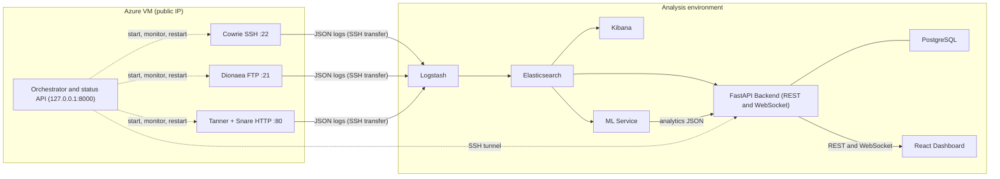

# Smart Honeypot Orchestrator & Threat Intelligence Dashboard

M.S. in Computer Science graduation project, Queen's University.

A platform that deploys honeypots on a public cloud host, manages their lifecycle automatically, normalizes the attack telemetry they collect, applies behavioral machine-learning analytics, and presents the results in a role-protected threat intelligence dashboard.

---

## Table of Contents

1. [Abstract](#1-abstract)
2. [Team and Supervision](#2-team-and-supervision)
3. [System Architecture](#3-system-architecture)
4. [Components](#4-components)
5. [Unified Event Schema](#5-unified-event-schema)
6. [Quick Start](#6-quick-start)
7. [Deployment](#7-deployment)
8. [Security and Ethics](#8-security-and-ethics)
9. [Results](#9-results)
10. [Limitations and Future Work](#10-limitations-and-future-work)
11. [Repository Structure](#11-repository-structure)
12. [Testing](#12-testing)
13. [Documentation Index](#13-documentation-index)
14. [References](#14-references)
15. [License and Acknowledgments](#15-license-and-acknowledgments)

---

## 1. Abstract

Security teams rarely see what attackers do after they find an exposed service. Honeypots, which are decoy systems with no legitimate users, capture that behavior, but running several of them, reconciling their different log formats, and turning the logs into actionable intelligence remains a manual effort.

This project builds an end-to-end pipeline for that task. Three open-source honeypots (Cowrie for SSH, Dionaea for FTP, and Tanner with Snare for HTTP) run as Docker containers on an Azure virtual machine with a public IP address. A Python **Orchestrator** controls their lifecycle and reports their health. Their logs are normalized by Logstash into a **unified 24-field event schema**, stored in Elasticsearch, and served by a FastAPI backend with JWT-based authentication and a WebSocket channel for live events. A machine-learning service assigns reconstructed attacker sessions to behavioral clusters using a frozen reference model, and a React dashboard presents live statistics and the ML analytics.

During about 19 days of continuous operation the system collected more than 200,000 events, dominated by automated scanning (see [Results](#9-results)).

## 2. Team and Supervision

**Students:** Asmaa Abouzina, Esraa Ouda, Hind Hussien, Hanaa Elganzory.

**Supervisor:** Dr. Anwar Hussien.

**Industry partner:** Fixed Solutions.

**Program:** M.S. in Computer Science, Queen's University.

## 3. System Architecture

The system is a pipeline of loosely coupled stages. Each stage talks to the next through a simple interface (log files, an indexed data store, HTTP, or WebSocket), so a stage can be replaced without changing the others. Only the data-collection layer is exposed to the Internet.



| From | To | Mechanism | Data |
|---|---|---|---|
| Honeypots | Logstash | Log files transferred over SSH | Raw JSON events |
| Logstash | Elasticsearch | HTTP indexing | Unified 24-field events |
| Elasticsearch | Backend | Aggregation queries and 5-second polling | Statistics, new events |
| Elasticsearch | ML Service | Read-only queries | Events for session analysis |
| ML Service | Backend | JSON analytics files | Clusters, MITRE, sessions, replay |
| Orchestrator | Backend | REST over an SSH tunnel | Honeypot health |
| Backend | Dashboard | REST and WebSocket | JSON |

## 4. Components

### 4.1 Honeypots (`honeypots/`)

| Honeypot | Protocol | Port | Captures |
|---|---|---|---|
| Cowrie | SSH | 22 | Brute-force attempts, shell commands, malware downloads |
| Dionaea | FTP | 21 | Authentication attempts and legacy exploit traffic |
| Tanner + Snare | HTTP | 80 | Web attack vectors, suspicious requests, payload attempts |

Each honeypot has its own Compose file, included by a master file, so they can be started together or debugged individually. Tanner runs with its supporting services (API, Redis, and a PHP sandbox).

### 4.2 Orchestrator (`Orchestrator/`)

A Python service that starts the enabled honeypot containers, checks their state every 30 seconds, restarts any that stopped, and exposes their status through a read-only `GET /status` endpoint. It controls existing containers through the Docker SDK and never builds them. Honeypots are declared in a YAML file, so they can be added or disabled without code changes. See [`Orchestrator/README.md`](Orchestrator/README.md).

### 4.3 Log collection and normalization (`elk/`)

Logstash reads the three honeypot log directories and maps every event into the unified schema. Events are then enriched with:

- **Geolocation:** country, country code, and ASN (MaxMind GeoLite2), for public addresses.
- **IP reputation:** a level of `high`, `medium`, `low`, `clean`, `unlisted`, or `private`, from public reputation sources.
- **Threat classification:** a rule-based, explainable mapping to `attack_type`, `mitre_technique`, `attack_stage`, and `severity`, aligned with MITRE ATT&CK.

The result is indexed in the `honeypot-events` index of Elasticsearch, and Kibana is used to explore and validate the data. See [`elk/README.md`](elk/README.md).

### 4.4 Backend (`Backend/`)

A FastAPI application (port 8001) that serves live statistics from Elasticsearch, serves the precomputed ML analytics, proxies the Orchestrator status, and handles authentication and administration in PostgreSQL (JWT, four roles, account activation, password reset, and an audit log). A background task pushes new events to dashboards over a WebSocket. See [`Backend/README.md`](Backend/README.md).

### 4.5 Machine-learning service (`ML_SERVICE/`)

A read-only microservice that turns events into behavioral analytics:

1. Reads events from Elasticsearch and reconstructs sessions by `session_id`.
2. Generates a 48-dimensional behavioral feature vector per session (volume, diversity, temporal, density, and geographic features).
3. Scales the features with a frozen scaler and assigns each session to the nearest centroid of a frozen clustering reference (derived with DBSCAN, 38 reference clusters).
4. Produces seven analytics layers: cluster, temporal, session, MITRE, MITRE statistics, MITRE trends, and session replay.

See [`ML_SERVICE/README.md`](ML_SERVICE/README.md) and `docs/datasets/` for the research pipeline.

### 4.6 Dashboard (`Frontend/`)

A single-page application built with React and Vite and served by nginx. REST calls load the charts, KPIs, and analytics, and a WebSocket keeps the live feed up to date. nginx forwards `/backend/` (REST and WebSocket) to the backend, so the browser needs a single address. Access requires login, and the account flows (activation and password reset) are part of the same application.

- **Dashboard:** key figures, attack trend, distribution by honeypot, top attackers, a world map of attack origins, recent attacks, and honeypot health.
- **Live Attacks:** a real-time feed of new events.
- **Statistics:** aggregated attack statistics.
- **Threat Intelligence:** cluster distribution, session summary and alerts, MITRE ATT&CK analytics and trends, and session replay (a step-by-step reconstruction of a session, with captured passwords masked by default).
- **Honeypots:** the state of each honeypot, refreshed every 30 seconds.
- **User management:** creation and administration of accounts (admin and sub-admin).

## 5. Unified Event Schema

Every event in Elasticsearch has the same 24 top-level fields, regardless of the honeypot that produced it.

| # | Field | # | Field |
|---|---|---|---|
| 1 | `timestamp` | 13 | `auth_attempt` |
| 2 | `honeypot` | 14 | `anonymous` |
| 3 | `protocol` | 15 | `command_count` |
| 4 | `source_ip` | 16 | `country` |
| 5 | `source_port` | 17 | `country_code` |
| 6 | `destination_ip` | 18 | `asn` |
| 7 | `destination_port` | 19 | `ip_reputation` |
| 8 | `session_id` | 20 | `attack_type` |
| 9 | `username` | 21 | `mitre_technique` |
| 10 | `password` | 22 | `attack_stage` |
| 11 | `user_attempt` | 23 | `severity` |
| 12 | `pass_attempt` | 24 | `source_dataset` |

A field that does not apply to an event is stored as `null` rather than invented (for example, `username` on an event that is not a login).

## 6. Quick Start

The analysis stack (Elasticsearch, Logstash, Kibana, PostgreSQL, backend, ML service, and dashboard) starts with one command. The orchestrator and the honeypots run separately.

**Prerequisites:** Docker with Compose v2, and at least 8 GB of RAM. On Linux, Elasticsearch may require `sudo sysctl -w vm.max_map_count=262144`.

```bash
# 1. configure
cp .env.example .env          # set POSTGRES_PASSWORD and JWT_SECRET_KEY

# 2. build and start
docker compose up -d --build

# 3. check (Elasticsearch needs one to two minutes to become healthy)
docker compose ps
```

| Service | URL |
|---|---|
| Dashboard | http://127.0.0.1:3000 |
| Backend API (Swagger UI) | http://127.0.0.1:8001/docs |
| Kibana | http://127.0.0.1:5601 |
| ML service | http://127.0.0.1:8000/docs |

- **Sign in** Sign in with admin@smarthoneypot.local / Admin@123456 (demo account created by seed_admin.py).
- **Data:** Logstash ingests the sample honeypot logs placed in `elk/logs/` on first start. Check progress with `curl http://localhost:9200/honeypot-events/_count`.
- **Kibana:** create a data view for `honeypot-events*` with `timestamp` as the time field.
- **ML analytics:** the files served by `/api/ml/*` must be present in `Backend/app/data/ml_analytics/`.
- **Stop:** `docker compose down` (add `-v` to remove stored data).

### Honeypots (optional, isolated machine only)

The honeypots bind ports 21, 22, and 80 of the host and attract real attacks when exposed. Run them only on a dedicated, isolated machine, after moving the host's own SSH service to another port:

```bash
docker compose -f honeypots/docker/docker-compose.yml up -d
```

Without the cloud VM or the SSH tunnel (see docs/DEPLOYMENT.md), the honeypot status panel shows `Orchestrator service is unavailable`; the rest of the dashboard is unaffected.

### Development without Docker

Each module can be run on its own. See [`Backend/README.md`](Backend/README.md), [`Orchestrator/README.md`](Orchestrator/README.md), [`ML_SERVICE/README.md`](ML_SERVICE/README.md), and [`Frontend/README.md`](Frontend/README.md).

## 7. Deployment

The honeypots first ran on a development machine, exposed through ngrok tunnels. This validated the full data path but lost the attacker's source address, because connections were relayed and address-translated, so the geographic and reputation analysis was impossible. The sensors were then moved to a cloud virtual machine with a static public address.

| Item | Value |
|---|---|
| Provider and region | Microsoft Azure, East US |
| Size and image | Standard_D2as_v7 (2 vCPU, 8 GiB RAM), Ubuntu Server 24.04 LTS |
| Authentication | SSH public key only |
| Exposed ports | 21 (Dionaea), 22 (Cowrie), 80 (Tanner and Snare) |
| Administration | SSH on port 2222, restricted to the administrator's address |

Only the honeypots and the orchestrator run in the cloud. The analysis stack runs locally and receives the logs over SSH. Elasticsearch, Kibana, the backend, and the ML service are not reachable from the Internet. Details (network rules, log transport, and the SSH tunnel to the orchestrator) are in [`docs/DEPLOYMENT.md`](docs/DEPLOYMENT.md).

## 8. Security and Ethics

- **Isolation.** Only the three honeypot ports are open to the Internet. Management access uses a non-standard SSH port, restricted by address, with key-based authentication only.
- **Reduced exposure.** The analysis stack is kept off the exposed host. The orchestrator status API listens on the loopback interface only.
- **Secrets.** Credentials, JWT secrets, API keys, and key files must never be committed. Use `.env` files (ignored by Git); `.env.example` contains placeholders only.
- **Development-only settings.** Elasticsearch security is disabled and demo accounts exist for local use. Neither is suitable for production. The Compose file publishes service ports on `127.0.0.1` only.
- **Docker socket.** TThe optional orchestrator Compose profile (disabled by default) mounts the Docker socket, which gives it full control of the Docker daemon. Use it only on a development or isolated machine.
- **Data handling.** Honeypot logs contain attacker IP addresses and attempted credentials. Publish collected logs only after sanitizing them.
- **Legal notice.** Deploy honeypots only on infrastructure you own or are authorized to use, isolated from production systems, and in line with the provider's acceptable-use policy and applicable law. This project is for academic and research purposes.

## 9. Results

Snapshot taken on **18 October 2026**, about 19 days after the cloud VM went live on 29 September 2026.

| Metric | Value |
|---|---|
| Total events | 201,098 |
| Events per honeypot | Tanner 135,406 (67.3%), Cowrie 65,035 (32.3%), Dionaea 657 (0.3%) |
| Unique source IP addresses | approximately 2,680 |
| Top source countries | Romania 43,603; Germany 31,491; France 27,755; United States 27,559; Netherlands 13,196 |
| Top attack types | web_scanning 86,088; scanning 53,245; sensitive_file_probe 37,077; brute_force 11,895; remote_code_execution 9,780 |
| Top MITRE ATT&CK techniques | T1595 Active Scanning 141,794; T1552.001 Credentials in Files 37,077; T1110 Brute Force 11,895; T1190 Exploit Public-Facing Application 9,780; T1078 Valid Accounts 306 |
| IP reputation | medium 89,395; high 83,667; low 19,229; unlisted 5,700; clean 3,069; private 3 |

**Observations**

- The traffic is dominated by automated scanning. Web scanning and generic scanning together account for about 69% of events (T1595 alone about 71%), followed by probing of sensitive files (about 18%), brute-force attempts (about 6%), and remote code execution attempts (about 5%).
- The five most active countries account for about 71% of events.
- Most sources are already known to public blocklists: about 86% of events come from addresses rated medium or high, and only about 4% are rated clean or unlisted.
- The number of unique addresses grew only slightly (from about 2,619 to 2,680) while the number of events more than doubled between two extractions, which suggests that a relatively small set of persistent sources generates most of the traffic.

**Effect of the cloud deployment**

| | ngrok phase | Cloud phase |
|---|---|---|
| `source_ip` | Docker bridge address | Attacker's public address |
| `country` and `asn` | Local and empty | Real country, populated |
| `ip_reputation` | private | high, medium, low, clean, unlisted |
| Availability | Personal machine, active session only | Continuous |
| Exposure of the development host | Direct | None |

## 10. Limitations and Future Work

**Limitations**

- **Single vantage point.** Data comes from one VM in one region, so it reflects the traffic that this address attracts.
- **Dionaea volume.** Only 657 FTP events were recorded, so conclusions about FTP behavior are limited.
- **Reputation sources.** `clean` means absence from the consulted sources, not benign behavior.
- **Polling-based streaming.** The live feed polls Elasticsearch every five seconds instead of using a push mechanism.
- **Development security settings.** Elasticsearch runs without security in the local environment.

**Future work**

- Classify attacks at the session level, using the most serious behavior in a session.
- Add further reputation sources and caching.
- Protect the data endpoints and the WebSocket with the existing role model.
- Replace polling with an event-driven stream.
- Run the ML pipeline on the live data on a schedule.
- Deploy honeypots in several regions and add more protocols.
- Secure Elasticsearch and move the analysis stack to managed infrastructure.

## 11. Repository Structure

```text
.
├── docker-compose.yml   # starts the whole analysis stack
├── .env.example
├── Backend/             # FastAPI backend (REST, WebSocket, authentication)
├── Frontend/            # React (Vite) dashboard, served by nginx
├── ML_SERVICE/          # Machine-learning microservice, frozen model, tests
├── Orchestrator/        # Python orchestrator and status API
├── elk/                 # Elasticsearch, Logstash, Kibana configuration and sample logs
├── honeypots/           # Cowrie, Dionaea, Tanner and Snare (Docker Compose)
├── notebooks/           # Research notebooks: preprocessing, features, ML
└── docs/                # Dataset, honeypot, ML, and deployment documentation
```

## 12. Testing

- **ML service:** an automated suite of unit, contract, and integration tests, run with `python -m pytest tests/ -q` from `ML_SERVICE/`. The pipeline was first validated end to end on mock data that follows the unified schema, and then run on real indexed events.
- **Backend:** endpoints are exercised interactively through Swagger UI, and the live stream with `Backend/test_websocket.py`.
- **Data path:** ingestion is verified at each stage: the honeypot log, the monitored directory, the Elasticsearch index, and Kibana.

## 13. Documentation Index

| Document | Content |
|---|---|
| [`Backend/README.md`](Backend/README.md) | Backend configuration, API reference, authentication |
| [`Orchestrator/README.md`](Orchestrator/README.md) | Orchestrator behavior, configuration, status API |
| [`ML_SERVICE/README.md`](ML_SERVICE/README.md) | ML pipeline, analytics layers, frozen model |
| [`elk/README.md`](elk/README.md) | Logstash pipeline and Elasticsearch index |
| [`Frontend/README.md`](Frontend/README.md) | Dashboard setup and integration notes |
| [`docs/DEPLOYMENT.md`](docs/DEPLOYMENT.md) | Cloud deployment, network rules, log transport |
| [`docs/datasets/`](docs/datasets/README.md) | Dataset preprocessing, sessions, features, ML, dashboard |
| [`docs/honeypots/`](docs/honeypots/deployment-and-troubleshooting.md) | Honeypot deployment and troubleshooting |
| [`docs/ml/`](docs/ml/ML_testing_and_Validation.md) | ML testing and validation report |
| [`notebooks/`](notebooks/README.md) | Research notebooks |

## 14. References

1. M. Oosterhof, *Cowrie SSH/Telnet Honeypot*. https://github.com/cowrie/cowrie
2. DinoTools, *Dionaea*. https://github.com/DinoTools/dionaea
3. MushMush, *Tanner* and *Snare*. https://github.com/mushorg/tanner, https://github.com/mushorg/snare
4. Telekom Security, *T-Pot* (maintained honeypot container images). https://github.com/telekom-security/tpotce
5. Elastic, *Elasticsearch, Logstash, and Kibana*. https://www.elastic.co
6. B. Strom et al., *MITRE ATT&CK: Design and Philosophy*, MITRE, 2018. https://attack.mitre.org
7. MaxMind, *GeoLite2 databases*. https://www.maxmind.com
8. M. Ester, H.-P. Kriegel, J. Sander, and X. Xu, *A Density-Based Algorithm for Discovering Clusters in Large Spatial Databases with Noise*, KDD, 1996.
9. S. Ramírez, *FastAPI*. https://fastapi.tiangolo.com

## 15. License and Acknowledgments

Developed for academic and research purposes. Third-party software (the honeypots, the ELK stack, and the libraries used) remains under its own license.

This project was carried out under the supervision of Dr. Anwar Hussien, with Fixed Solutions as industry partner. This product includes GeoLite2 data created by MaxMind, available from https://www.maxmind.com.
